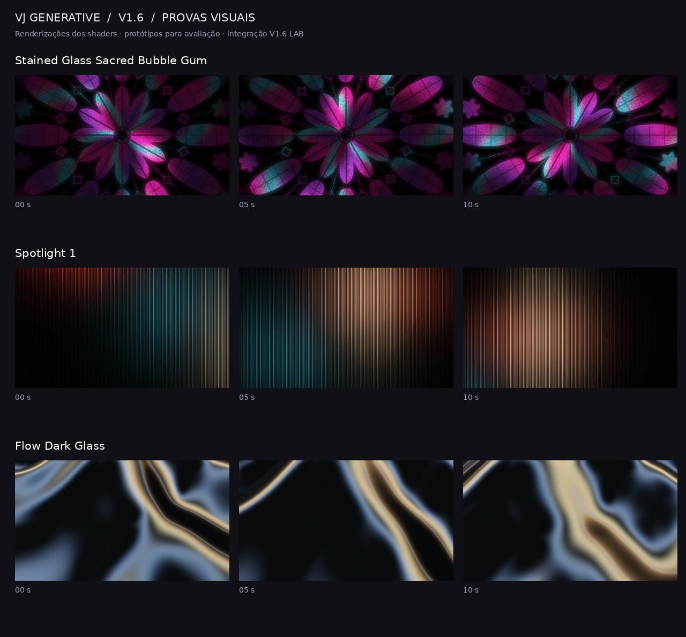

# V1.6 — Gate A: primeiras provas visuais

Três implementações GLSL independentes, renderizadas em OpenGL 4.1:

1. **Stained Glass Sacred Bubble Gum** — rosácea procedural, juntas e tesselas de vidro, contraluz rosa/ciano.
2. **Spotlight 1** — vidro canelado com iluminação colorida que se desloca por trás. O link recebido pertence à coleção **Glass**, não a fachos de palco.
3. **Flow Dark Glass** — superfície ondulada intersectada em perspectiva, oclusão de dobras, Fresnel e reflexos de luzes amplas.

São **protótipos para avaliação**, agora integrados ao código da DLL de desenvolvimento [V1.6 LAB](../../docs/V1_6_LAB.md). Não são versões finais. Foram examinadas as thumbnails e seis quadros distribuídos nas prévias públicas de 15 segundos de cada referência; a inspeção de todos os frames dos originais permanece pendente. Nenhuma imagem/vídeo do catálogo é usada como textura ou distribuída neste código.

## Avaliação visual



Vídeos completos de 20 segundos, 960×540, 30 fps:

- [Stained Glass Sacred Bubble Gum](../../previews/gate_a/stained_glass_20s.mp4)
- [Spotlight 1](../../previews/gate_a/spotlight_20s.mp4)
- [Flow Dark Glass](../../previews/gate_a/flow_dark_glass_20s.mp4)

Quadros também renderizados em LED 3360×1008, sem esticar o eixo horizontal. O viewport define a proporção de câmera; aspectos extremos revelam ou recortam áreas da cena.

## Render reproduzível

```bash
pip install -r prototypes/gate_a/requirements.txt
python tools/render_gate_a.py --video
```

Requer OpenGL/EGL 4.1 e FFmpeg. A composição usa buffers RGBA16F, desfoque separável para luz difusa, tone mapping e dither antes da saída de 8 bits. Fontes GLSL independentes mantêm inalterados `VJGenerative.cpp`, `shaders.h`, `shaders_expansion.h` e `palettes_extra.h`.

## Verificado nesta etapa

- Compilação e render OpenGL via Mesa llvmpipe, **software**, não uma NVIDIA.
- 3 quadros por motor; saída não preta; diferenças entre motores e ao longo do tempo.
- Movimento periódico de 20 s a velocidade 1: comparação do início/fim e dos frames adjacentes à emenda.
- Resposta de Escala, Intensidade, Matiz, Simetria, Semente, Detalhe, Profundidade, Densidade, Glow, Velocidade, Direção, Pulso e BPM com Pulso ativo.
- Velocidade zero pausa a evolução; opacidade 25% resulta em alpha 64/255.
- Render em 1920×1080, 3360×1008, 3840×2160 e 1080×1920.
- O shader clássico mantém o blob Git `488f842c06fe9fa616d71b033e32c573fe90179a`.

Resultados numéricos: [validation.json](../../previews/gate_a/validation.json).

## Limites e próximo passo

Estes testes não comprovam 60 fps na RTX, funcionamento no Resolume nem fidelidade visual final. Bloom é difusão da imagem em duas passagens, ainda sem pirâmide multiescala ou extração seletiva de highlights. Reflexão/refração são aproximações procedurais; não há ray tracing completo.

O loop geométrico é periódico; com BPM arbitrário e Pulso ativo, o fechamento total exige compatibilizar período e número de batidas. Mudanças instantâneas de controles podem alterar a imagem sem transição nesta prova. A versão FFGL de desenvolvimento acumula tempo e batidas, inclui as 36 paletas e RGBA e restaura estados OpenGL. Ainda é necessário verificar seleção/persistência no Resolume. Os vídeos desta pasta usam cores de referência e Matiz.

O operador autorizou continuar e corrigir o necessário; a integração de teste foi iniciada em src/v16, sem declarar aprovação artística dos protótipos. A DLL Windows só está disponível após o build correspondente ter sucesso. Walls — Names of God e os demais 72 motores novos continuam pendentes.
